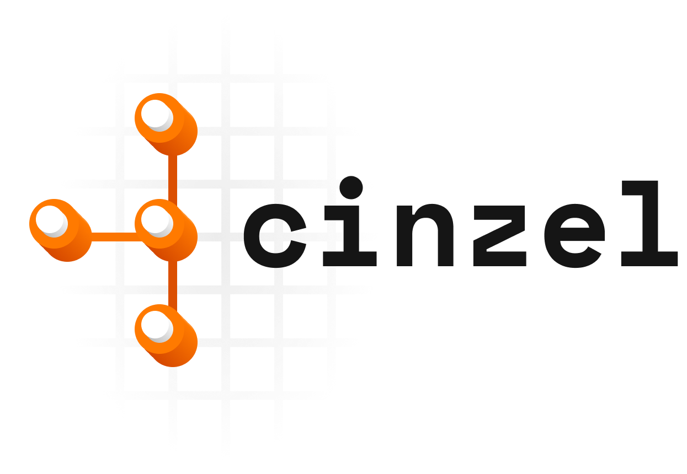

# cinzel



**`cinzel`**, pronounced "*sin-ZEL*" ([IPA](https://en.wikipedia.org/wiki/International_Phonetic_Alphabet): /sĩˈzɛl/), is the Portuguese word for **chisel**.

It converts CI/CD pipelines between [YAML](https://yaml.org) and
[HCL](https://github.com/hashicorp/hcl), in both directions, for GitHub Actions
and GitLab CI/CD.

Made with :heart: by [YLD Limited](https://www.yld.com/).

## Why

YAML pipelines grow by copy and paste. There is no way to say "this step, the
one I already wrote", so you write it again, and the fourth copy drifts from the
first.

HCL has references. A step is a block, and a job points at it by name:

```yaml
# .github/workflows/ci.yaml
name: CI
on:
  push:
    branches: [main]
jobs:
  build-and-test:
    runs-on: ubuntu-latest
    steps:
      - uses: actions/checkout@v4
      - name: Test
        run: go test ./...
```

```hcl
# cinzel/ci.hcl — the same job. Its step blocks sit further down the file.
job "build_and_test" {
  id = "build-and-test"

  runs_on {
    runners = "ubuntu-latest"
  }

  steps = [
    step.checkout,
    step.test,
  ]
}
```

`step.checkout` is a real reference. Rename the block and every job using it
follows. Write the step once and ten jobs can share it. GitHub and GitLab still
only read YAML, so cinzel converts back.

Comments survive the trip, in both directions and in all three positions — a
comment above a block, one beside a value, one closing a body. The note saying
why a version is held back is still there after the conversion.

One cannot be carried: the comment above `env`, `with`, `outputs` or
`secrets`. Each is one mapping in YAML and one block per key in HCL, so there
is no block to hold a note about the whole set. Unparse drops it and prints
where it was, as `file:line: path`, rather than silently pinning it to the key
that happens to sort first.

## Install

Download a binary from [Releases](https://github.com/yldio/cinzel/releases), or:

```sh
brew tap yldio/cinzel && brew install --cask cinzel
```

```sh
go install github.com/yldio/cinzel@latest
```

Then `cinzel --help`.

## Start from what you have

Point `unparse` at a pipeline you already run:

```sh
cinzel github unparse --file .github/workflows/ci.yaml --output-directory ./cinzel
cinzel gitlab unparse --file .gitlab-ci.yml --output-directory ./cinzel
```

Edit the HCL, then convert it back:

```sh
cinzel github parse --file ./cinzel/ci.hcl --output-directory .github/workflows
cinzel gitlab parse --file ./cinzel/.gitlab-ci.hcl --output-directory .
```

Add `--dry-run` to either to see the result without writing anything.

Converting is a conversion, not a rewrite: what the YAML says is what the HCL
says, and parse writes back what the HCL holds. cinzel adds no keys of its own
— a workflow that declares no `permissions` gets none, and what a pipeline
ought to declare is for you and your linter to settle.

The two providers work the same way but their HCL differs, because the
platforms do:

- [GitHub Actions](provider/github/README.md) — workflows, composite actions,
  and the step reference graph.
- [GitLab CI/CD](provider/gitlab/README.md) — jobs, templates, includes, and
  the pipeline keywords.

## Flags

`parse` and `unparse` share these:

| Flag | Description |
| --- | --- |
| `--file`, `-f` | Read one file. A directory is refused; `--directory` is for that. |
| `--directory`, `-d` | Read every matching file in a directory. Not with `--file`. Repeatable on unparse; parse takes one. |
| `--recursive`, `-r` | Walk subdirectories of `--directory`. |
| `--root` | Resolve every path against this directory instead of the working directory. Not with `--output-directory`. |
| `--output-directory` | Where to write. Parse defaults to `.github/workflows` (GitHub) or the working directory (GitLab); unparse defaults to `./cinzel`. Superseded by `--root`. |
| `--dry-run` | Print instead of writing. |

`parse` also takes `--yml` to write `.yml` instead of `.yaml`. GitLab parse
always writes `.gitlab-ci.yml`, so it changes nothing there.

`cinzel fmt` rewrites the HCL in the canonical layout. With no flags it
formats wherever your HCL lives: the directories named in `.cinzelrc.yaml`,
or `./cinzel` when there is no config. `--file` and `--directory` name one
explicitly, `--recursive` walks subdirectories, and `--check` names the files
that would change and exits non-zero without writing one. A run that finds no
HCL at all fails rather than reporting a clean check.

GitHub unparse always reads `.github/workflows`, whatever else `--directory`
names, since that is the only place GitHub reads a workflow from. Naming it
explicitly still works and warns, and a repository without one is passed over
rather than failed.

`unparse --mirror` lays the HCL out the way the repository is laid out —
`cinzel/actions/setup.hcl` rather than `cinzel/setup.hcl` — which reads
better in a tree. Where a file goes on the way back is its own `path` either
way, so this is a convenience, and a mirrored tree has to be parsed with
`--recursive`.

A composite action sits at `<dir>/<name>/action.yml`, so a folder of actions
holds no YAML of its own. `-d .github/actions` reads the actions one level
down without `--recursive` being typed as well; anything deeper still needs
the flag.

Workflows stay at the top of the output directory even under `--mirror`.
`.github/workflows` is the one place GitHub reads a workflow from, so it is
not a layout worth reproducing: parse writes every workflow back there
whatever the HCL is called, and a mirrored `cinzel/.github/workflows` is a
directory nothing reads.

If you keep composite actions in folders of their own, one run each way
converts the lot:

```sh
cinzel github unparse -d actions-x -d actions-y -r --output-directory cinzel
cinzel github parse -d cinzel
```

Each action remembers where it came from, so parse puts it back there. The
[GitHub provider README](provider/github/README.md) covers the `path` attribute
that holds it.

### `--root`, and `--output-directory`

`--output-directory` says where one kind of file goes. `--root` says where the
whole output shape goes, which is one answer instead of one per document type.
It must be a path relative to where cinzel runs:

```sh
cinzel github parse --root project-x
# → project-x/.github/workflows/ci.yaml
# → project-x/actions-x/setup/action.yml
```

It applies to both directions and both providers, and on unparse it is the
base for what is read as well as what is written. Setting it together with
`--output-directory` is an error rather than a precedence rule.

`--output-directory` still works and is unchanged, and nothing is scheduled to
remove it. `--root` is the one to reach for in new work: it says where
everything goes rather than where one kind of file goes, which is the shape a
repository with actions outside `.github/workflows` needs.

## Defaults in a file

Put the flags you always pass into `.cinzelrc.yaml` and stop typing them:

```yaml
github:
  parse:
    directory: ./cinzel
    output-directory: .github/workflows
    yml: false
    recursive: true
```

A flag on the command line still wins, including `--recursive=false` against a
file that sets it true. It covers `parse` and `unparse` only, per provider —
`assist`, `pin`, `upgrade` and `init` ignore it. The keys are `file`,
`directory`, `output-directory`, `yml`, `recursive` and `ignore-unknown`; the
last three are booleans, written bare rather than quoted. `yml` only affects
parse and `ignore-unknown` only unparse, so each is accepted and ignored under
the other. Anything else prints `warning: ...: unknown key` and is skipped.

Paths must be relative and written with forward slashes. The file is meant to
be committed and read on every machine that checks the repo out, so an absolute
path or a leading `~` is refused with an error naming the key. Forward slashes
are converted to whatever the running system separates with, so one spelling
works on Linux, macOS and Windows.

## A key cinzel does not know

A YAML key the schema does not declare stops the conversion, naming the key
and the line. That is the right answer for a typo: the file is left as it was,
with nothing lost.

`unparse --ignore-unknown` drops those keys instead, naming each one with its
file and line. It is worth knowing what that costs. The key is gone from the
HCL, so it is gone from the YAML the next parse writes — over the file it came
from. `diff` reports no drift afterwards, because the HCL and the YAML agree:
they agree on a document missing a key you wrote. Reach for it when a key is
one cinzel's schema has not caught up with, not to get past a typo.

## Keeping the two in step

Once the HCL is the source, the YAML under `.github/workflows` is output, and
an edit made there goes away the next time anyone runs parse. Nothing stops
that edit at the time it is made, so check for it:

```sh
cinzel github diff
cinzel gitlab diff
```

It reports what a parse would change and writes nothing. As the first step of
a workflow it fails the run when the committed YAML is not what the HCL
produces:

```yaml
- name: Pipelines match their HCL
  run: cinzel github diff
```

Three outcomes, so a workflow can tell them apart:

| Exit | Meaning |
| --- | --- |
| 0 | The committed YAML is exactly what the HCL produces. |
| 1 | Something drifted. Every file is named, with the lines that differ. |
| 2 | cinzel could not work it out: unreadable HCL, a missing directory. |

```diff
.github/workflows/pull-request.yaml differs
@@ -10,7 +10,7 @@
 jobs:
   pull_request:
     name: "${{ matrix.os }}"
-    runs-on: ubuntu-24.04
+    runs-on: "${{ matrix.os }}"
     steps:
       - id: checkout
         name: Checkout

would delete: .github/workflows/old-ci.yaml (generated by cinzel, no longer written)

Diff summary: 3 checked, 1 differ, 0 would be created, 1 would be deleted
```

Removed lines are red and added ones green on a terminal, and plain
everywhere else — a pipe, a file, a CI log. Set `NO_COLOR` to anything, the
empty string included, to turn it off on a terminal too.

The `-` and `+` sit in their own column rather than against the text, so the
content starts in the same place on every line. Written the usual way, the
marker shifts the indentation of exactly the lines you are reading the
indentation of.

`would delete` is the one a plain `diff -ru` against a freshly parsed copy
cannot report. Parse prunes generated YAML it no longer writes, so a renamed
workflow leaves its old output behind — and a directory comparison reads that
as a file missing on one side, which looks the same as drift and never clears.

It takes `parse`'s input and output flags — `--file`, `--directory`,
`--recursive`, `--output-directory` and `--yml` — and not `--root` or
`--dry-run`, since it writes nothing. It reads the same `.cinzelrc.yaml`
section, since it is answering what parse would do. A CRLF checkout is not
reported as drift: generated files are written with LF, and git converts line
endings on Windows by default.

One thing to know: the `cinzel-source` marker records the HCL file a workflow
came from, relative to where cinzel ran. Run `diff` from a different directory
than the last `parse` and that line differs, so the file is reported even
though its YAML says the same thing. Run both from the repository root.

## Generating a pipeline from a prompt

```sh
cinzel github assist --prompt "golang PR with tests and linting"
```

This asks an LLM for a pipeline, converts it through the same unparse path your
own YAML goes through, and writes HCL to a timestamped folder. Blocks matching
HCL you already have are replaced with a `// reuses:` comment rather than
duplicated. For GitHub, action versions are pinned to SHAs on the way out.

```
cinzel/assist/
  20260317-150405/     # first prompt
    assist.hcl
  20260317-151200/     # second prompt
    assist.hcl
```

Refine what came back, against the latest session or a named one:

```sh
cinzel github assist --refine "add slack notification on failure" --prompt "add to PR workflow"
cinzel github assist --refine "add caching" --from 20260317-150405
```

It needs an API key, read from the environment:

```sh
export ANTHROPIC_API_KEY=...
# or
export OPENAI_API_KEY=...
cinzel github assist --ai openai --prompt "..."
```

`cinzel init` writes a config holding your default provider and the model to
use for each. It deliberately does not hold a key: that file lands on disk and
gets swept into a backup of your home directory, so the environment is the
place for one.

Other `assist` flags:

| Flag | Description |
| --- | --- |
| `--output-directory` | Where session folders go (default `cinzel/assist`). |
| `--dry-run` | Print instead of writing. |
| `--acknowledge` | Skip the cost confirmation. |
| `--ai` | `anthropic` or `openai`. |
| `--model` | Model override. |
| `--no-context` | Do not send your existing HCL as context. |
| `--context-dir` | Where to read that context from (default `cinzel`). |

Both providers support `assist`.

## Pinning action versions

GitHub only; GitLab has no equivalent.

```sh
cinzel github pin                # rewrite every action tag as the SHA it points at
cinzel github upgrade            # bump to latest, then pin
cinzel github upgrade --parse    # and regenerate the YAML
```

Both take `--dry-run`, `--file`/`-f` and `--directory`/`-d` (default `cinzel`).
`upgrade --parse` writes to `--output-directory` (default `.github/workflows`).

Either command exits non-zero when it could not resolve an action, so a CI step
running `cinzel github pin --dry-run` fails on a workflow that still holds an
unpinned one. Each failure is named as it happens and the summary line counts
them.

No token is needed for public actions. `GITHUB_TOKEN` raises the rate limit
from 60 an hour to 5000.

## Using it from an agent

There is a skill for Claude Code, Codex, opencode and pi, so an agent knows
what the HCL looks like and which command goes which way:

```
/plugin marketplace add yldio/cinzel
/plugin install cinzel@cinzel-plugin
```

See [`plugins/cinzel/README.md`](plugins/cinzel/README.md) for the other
agents, which read the same `SKILL.md` from their own skills directory.

## More

- [Changelog](CHANGELOG.md)
- [Contributing](CONTRIBUTING.md) — and the
  [Discussions](https://github.com/yldio/cinzel/discussions), worth reading
  before opening an issue or a PR
- [Code of Conduct](./CODE_OF_CONDUCT.md)
  [](./CODE_OF_CONDUCT.md)
- [Homebrew release automation](docs/release/homebrew.md), for release operators

Licensed under Apache-2.0. See [LICENSE](./LICENSE).
